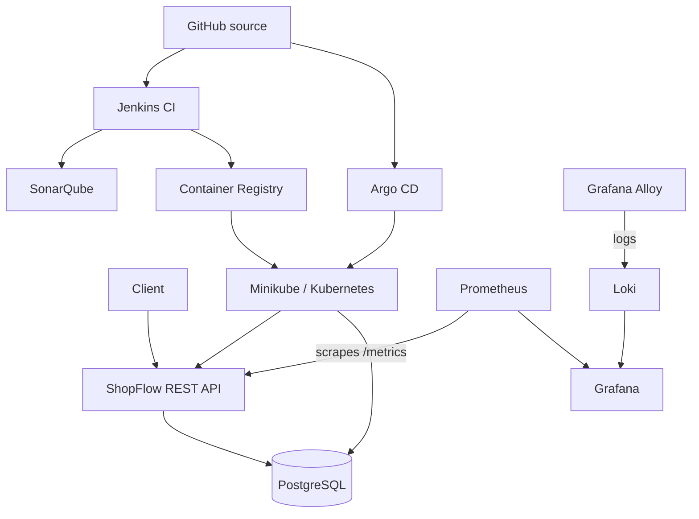

# ShopFlow architecture

CI builds and tests application code, runs analysis, builds/scans an image and publishes an immutable tag. The desired image tag is committed to GitOps manifests; Argo CD reconciles those manifests into Kubernetes. Prometheus, Alloy and Loki provide metrics and logs for troubleshooting.
